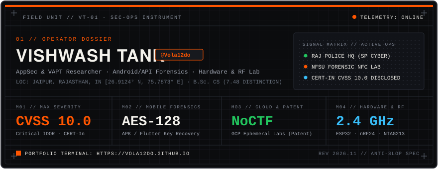

<div align="center">

```ascii
╔══════════════════════════════════════════════════════════════════════════════╗
║  Application Security Researcher • Android & API VAPT • Hardware & RF Lab    ║
╚══════════════════════════════════════════════════════════════════════════════╝
```

[](https://vola12do.github.io/)
[](https://www.linkedin.com/in/vishwash-tank-89308b28b/)
[](https://medium.com/@vishwashtank)
[](mailto:vishwashtank@gmail.com)

</div>

### 👨‍💻 About Me

```rust
fn main() {
    let operator = SecurityResearcher {
        name: "Vishwash Tank",
        alias: "Vola12do",
        location: "Jaipur, Rajasthan, India 🇮🇳",
        current_role: "Cyber Crime Intern @ Rajasthan Police HQ (SP Cyber Crime)",
        prior_roles: vec![
            "Technical Project Associate @ NFSU Gandhinagar (Forensic NFC Lab)",
            "Junior Cybersecurity Trainer @ Cyber Octet Pvt. Ltd.",
        ],
        education: "B.Sc. Computer Science — Gujarat University (7.48 CGPA • Distinction)",
        languages: vec!["Python", "C++", "Bash", "SQL", "JavaScript"],
        specialties: vec![
            "Web & REST API VAPT (OWASP Top 10 / API Top 10 / BOLA / IDOR)",
            "Android & Flutter Reverse Engineering (JADX, APKTool, MobSF, AES Entropy)",
            "IoT & RF Hardware Auditing (ESP32, ESP8266, nRF24L01, NTAG213 RFID, HID)",
            "Cloud & SIEM Telemetry (GCP, Docker, Splunk, Elastic Stack, Suricata)",
        ],
        disclosures: "CERT-In Coordinated Disclosure (Critical IDOR — CVSS v3.1: 10.0)",
        patents: "NoCTF — Ephemeral Containerized Labs-as-a-Service (Patent Filed)",
        portfolio: "https://vola12do.github.io/",
    };

    println!("Reproducible diagnostics, root-cause isolation, and zero-slop security engineering.");
}
```

<br clear="right"/>

### Knowledge & Skills:

<br>

<div style="border: 2px solid #FF5500; border-radius: 10px; padding: 20px; margin-bottom: 20px;">
  <div align="center" style="display: flex; flex-wrap: wrap; justify-content: center; gap: 10px;">
      
      
      
      
      
      
      
      
      
      
      
      
      
      
      
      
      
      
      
      
  </div>
</div>

### Field Telemetry:
<div align="center">
  <a href="https://vola12do.github.io/">
    
  </a>
</div>

<br>

### Vulnerability Discoveries & Systems Engineered:

| ID | Advisory / System | Classification | Technical Summary |
| :--- | :--- | :--- | :--- |
| **`[VULN-01]`** | **Critical IDOR & Broken Access Control** | **`CVSS 10.0` · CERT-In** | Identified critical authorization bypass in enterprise web infrastructure enabling unauthorized cross-tenant data access; coordinated disclosure via **CERT-In**. |
| **`[VULN-02]`** | **Hardcoded AES-128-GCM Mobile Keys** | **Mobile / Flutter RE** | Extracted static AES-128 keys and cleartext storage from decompiled bytecode (`JADX` / `APKTool` / `MobSF`) via Shannon entropy analysis for offline decryption. |
| **`[VULN-03]`** | **Broken Object Level Authorization (BOLA)** | **OWASP API1:2023** | Mapped REST API endpoints via `HTTP Toolkit` & `Burp Suite` and proved cross-account data access due to missing server-side object ownership checks. |
| **`[SYS-01]`** | **NoCTF — Labs-as-a-Service** | **GCP · Docker · Patent Filed** | Self-built ephemeral offensive security lab platform provisioning isolated Docker environments on GCP with Supabase authentication. |
| **`[SYS-02]`** | **Smart Denture Forensic NFC Scanner** | **NFSU Gandhinagar** | Embedded passive `NTAG213` RFID/NFC micro-tags into dental prosthetics with `RC522` Arduino firmware for disaster victim identification under thermal stress. |
| **`[SYS-03]`** | **SOARX & RF Hardware Toolkits** | **Python · ESP32 · nRF24L01** | Built [`LaptopSecurityDashboard`](https://github.com/Vola12do/LaptopSecurityDashboard), [`gtd-dashboard`](https://github.com/Vola12do/gtd-dashboard), [`BLE_Jammer`](https://github.com/Vola12do/BLE_Jammer_Using_ESP32_And_Nrf24l01_), [`ESP8266_Deauther`](https://github.com/Vola12do/IoT-WiFi-Attack-Tools-ESP8266-Deauther), and [`Rubber_Ducky_HID`](https://github.com/Vola12do/IoT-Rubber-Ducky-Using-Arduino-Micro-Controller). |

### GitHub Stats:
<div align="center">
  <br/>
  <br/>
  
</div>

---
[](https://visitcount.itsvg.in)


